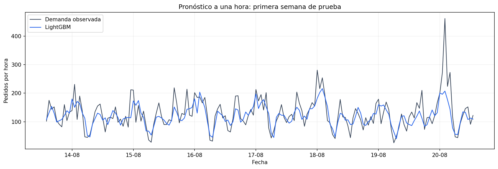
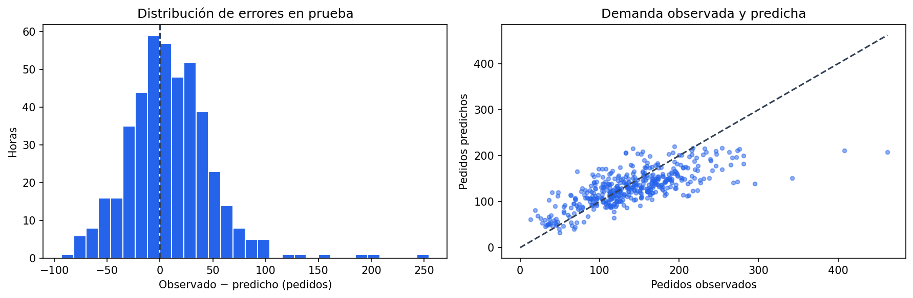

# Pronóstico horario de demanda de taxis

Desarrollé un modelo para estimar los pedidos de taxis de la próxima hora y apoyar la planificación de conductores de **Sweet Lift Taxi**. Este proyecto forma parte del bootcamp de Data Science de **TripleTen**.

Transformé registros de diez minutos en una serie horaria, creé características basadas en el historial y comparé modelos respetando el orden temporal. Seleccioné **LightGBM** por su menor RMSE promedio de validación entre los modelos entrenados.

**Autor:** [Luis Eduardo Aguilar Castellanos](https://github.com/EdAgZer03)  
**Tecnologías:** Python · pandas · NumPy · scikit-learn · LightGBM · statsmodels · Matplotlib · Jupyter

## Resultados

| Indicador | Resultado |
|---|---:|
| Modelo seleccionado | LightGBM |
| RMSE promedio de validación temporal | 26.51 pedidos |
| RMSE en prueba | 41.12 pedidos |
| Máximo establecido para el proyecto | 48 pedidos |
| Referencia: repetir la hora anterior, en prueba | 58.86 pedidos |
| Referencia: repetir la misma hora del día anterior, en prueba | 57.19 pedidos |
| Reducción de RMSE frente a la hora anterior | 30.1 % |
| Horas evaluadas en prueba | 442 |

Cumplí el objetivo de RMSE ≤ 48 y reduje el error frente a las dos referencias temporales. Comparé los tres pronósticos sobre las mismas 442 horas de prueba.



## Explora el proyecto

- [Notebook ejecutado](pronostico_demanda_taxis.ipynb): análisis, código, gráficos y conclusiones.
- [Métricas y configuración](reports/metrics.json): resultados completos y versiones.
- [Comparación de modelos en validación](reports/model_comparison.csv) y [comparación en prueba](reports/test_comparison.csv).
- [Búsqueda de características](reports/feature_comparison.csv): combinaciones de retardos y media móvil.
- [Datos](data/README.md): descripción y configuración del archivo de entrada.

## Problema y enfoque

La disponibilidad de conductores debe responder a cambios horarios en la demanda. Mi objetivo fue pronosticar el número de pedidos de la siguiente hora, usando información que ya estuviera disponible al emitir cada predicción.

Actualicé el pronóstico hora a hora utilizando las observaciones reales disponibles hasta la hora anterior. Este esquema permite incorporar el historial reciente en cada nueva predicción.

## Decisiones técnicas

1. **Agregación horaria.** Comprobé orden, duplicados, ausencias y continuidad de los intervalos de diez minutos. Sumé los pedidos de cada hora para formar la variable objetivo.
2. **Separación cronológica.** Reservé el 10 % final sin mezclar registros. Realicé la exploración para orientar el modelo sobre entrenamiento.
3. **Características sin datos futuros.** Incluí hora, día de la semana, 24 retardos y una media móvil de 6 horas. Apliqué `shift(1)` antes de calcularla, excluyendo la hora que intento predecir.
4. **Selección mediante validación temporal.** Comparé 12 configuraciones de características con regresión lineal y después evalué regresión lineal, bosque aleatorio y LightGBM. Para cada ensamble probé nueve combinaciones con tres divisiones de `TimeSeriesSplit`.
5. **Referencias comparables.** Evalué persistencia de una hora y persistencia diaria sobre las mismas fechas de validación y prueba que los modelos.

## Evaluación temporal

Dividí las **4416 observaciones horarias** en orden cronológico: 90 % para entrenamiento y 10 % para prueba. Dentro de entrenamiento utilicé tres divisiones de `TimeSeriesSplit`, siempre entrenando con las horas anteriores al intervalo de validación.

Elegí las características y los hiperparámetros según el menor RMSE promedio de las tres divisiones. Con la configuración seleccionada evalué las **442 horas finales**, del **13 al 31 de agosto de 2018**, y comparé LightGBM con las referencias de la hora anterior y del día anterior.

## Análisis de errores



El modelo siguió el patrón horario general, pero subestimó los picos más altos de demanda. En prueba, la diferencia media entre pedidos observados y predichos fue de **9.38 pedidos**, con errores positivos más grandes en las horas de mayor actividad.

## Datos

Utilicé `taxi.csv`, proporcionado para el caso académico Sweet Lift Taxi: pedidos cada diez minutos entre marzo y agosto de 2018. El archivo original no se distribuye. El repositorio incluye gráficos y resultados agregados.

Si cuentas con los datos del ejercicio, configura `TAXI_DATA_PATH` o coloca el archivo en `data/raw/taxi.csv`, que Git ignora. [Consulta las instrucciones](data/README.md).

## Ejecutar localmente

**Requisitos:** Python 3.9.23 en Windows, pandas 1.2.4, scikit-learn 0.24.1, LightGBM 3.3.1 y statsmodels 0.13.5.

Desde la raíz del repositorio:

```powershell
python -m venv .venv
.\.venv\Scripts\Activate.ps1
python -m pip install -r requirements-lock.txt
$env:TAXI_DATA_PATH = 'C:\ruta\a\taxi.csv'
python scripts/execute_notebook.py
```

También puedes abrir el notebook en un editor compatible con Jupyter usando ese intérprete. El script usa un kernel temporal, ejecuta las celdas en orden y se detiene si encuentra un error.

`requirements.txt` contiene las dependencias principales y `requirements-lock.txt` sus dependencias transitivas. Utiliza Python 3.9.23 para instalar esta configuración.

## Limitaciones y siguientes pasos

- La muestra cubre seis meses; necesito más períodos para estudiar estacionalidad y estabilidad del error.
- La búsqueda de características y parámetros reutiliza los folds de desarrollo, lo que puede favorecer sus métricas.
- El pronóstico requiere recibir observaciones reales cada hora. Para otros horizontes tendría que diseñar y evaluar otro procedimiento.
- Eventos, clima y cambios operativos pueden modificar la demanda. Los patrones observados no demuestran sus causas.
- Antes de utilizar el modelo para asignar conductores, evaluaría su efecto sobre disponibilidad, tiempos de espera y costos.

## Contacto

[GitHub](https://github.com/EdAgZer03) · [LinkedIn](https://www.linkedin.com/in/luis-eduardo-aguilar-castellanos-data-scientist/)
